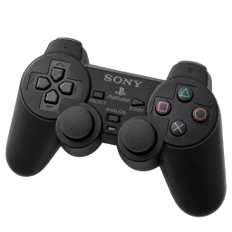
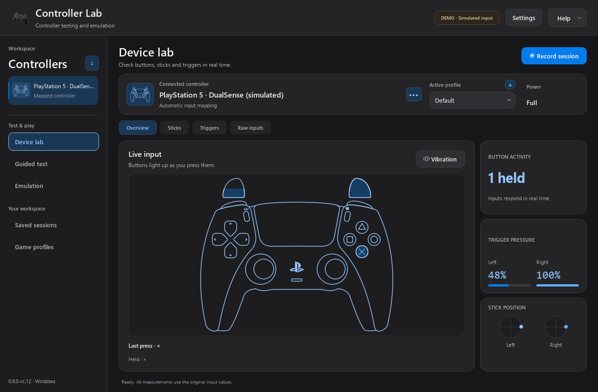
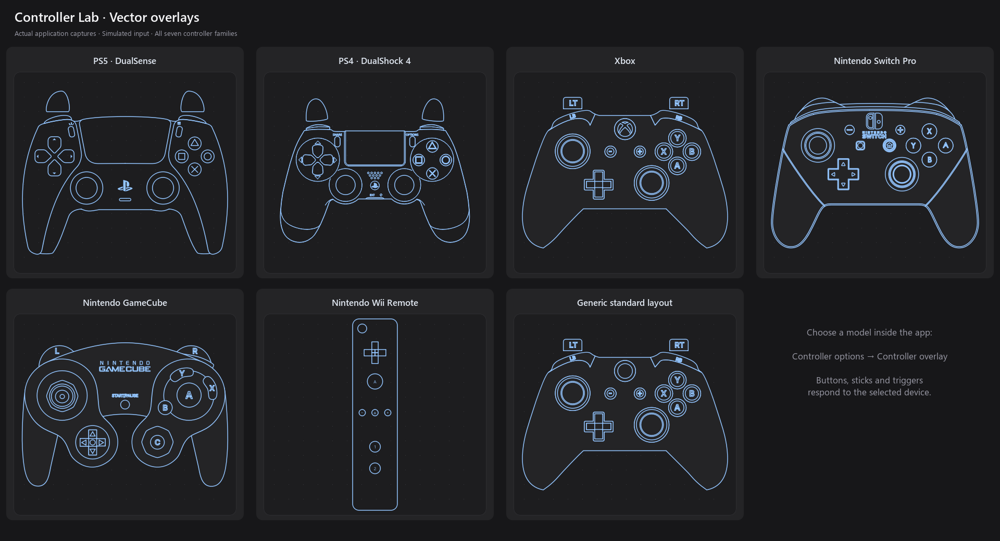
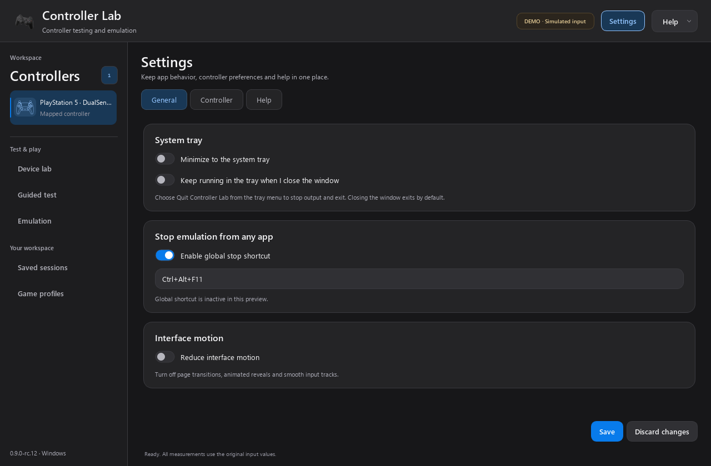

<div align="center">
  
  <h1>Controller Lab</h1>
  <p>A closer look at every input.</p>
  <p><strong>Windows x64 · English interface · 0.9.0 RC12</strong></p>
</div>

Controller Lab is a desktop workspace for testing gamepads: see live buttons,
trace stick movement, observe triggers and save measurements for comparison.
It runs locally without a Steam login, API key or game hooks. An optional Emulation
workspace can bridge a mapped input to Xbox 360 or DualShock 4 virtual output.

This release candidate needs wider hardware and game validation. After repairing
ViGEmBus on the development PC, the packaged application successfully created
neutral Xbox 360 and DualShock 4 virtual targets and detached them. This check
did not forward physical inputs or request vibration; in-game input and vibration
remain unverified. See [emulation setup and evidence](docs/EMULATION.md) and the
[release checklist](docs/RELEASE_CHECKLIST.md).



*Actual application UI, with explicitly simulated inputs for the screenshot.*



## What it does

- First-run setup assistant with input mapping and an optional neutral virtual-output check.
- A system tray menu to restore the app, stop emulation or quit, with optional
  minimize/close-to-tray behavior under Desktop settings.
- A configurable global stop shortcut, **Ctrl+Alt+F11** by default.
- Opt-in game profiles matched to a running game's full executable path. Profile
  changes stop output; your manual preset returns when the game closes.
- Detect connected devices and choose a controller illustration automatically.
- Show the detected controller's artwork in the device list and summary. A manual
  testing-overlay choice does not change the detected-device thumbnail.
- A guided checklist for exposed buttons/directions, sticks, triggers, center and
  optional vibration, with pending inputs kept distinct from failed hardware.
- Visual session reports with recorded stick trails and PNG/HTML/JSON/CSV export.
- Named profiles, input capture with **Listen**, and configurable output mappings.
- Search, rename, import, compare, delete and restore saved sessions.
- Optional Xbox 360/DS4 virtual output: deadzone, response curve, sensitivity,
  Y inversion, stick swap, button remapping and opt-in game vibration forwarding.
- Compatibility observations and copyable connection diagnostics.
- A structured dark workspace with consistent typography, a device summary,
  persistent controller sidebar and uncluttered live preview.
- A precision-style preview stage, compact live trigger readouts and distinct
  connection/output statuses. Unavailable readings stay distinct from zero.
- Blue vector overlays for DualSense, DualShock, Xbox, Nintendo Switch,
  GameCube, Wii Remote and a generic standard layout.
- Original vector contours and proportions, preserved at every window size.
- Front-facing Xbox artwork and consistent screen-space outline weights.
- Individually illuminated buttons, moving stick caps and pressure-filled triggers.
- Centered PlayStation face symbols, with optical alignment for the triangle.
- A neutral standard layout for generic controllers without a known model.
- Manual overlay override under **Controller options → Controller overlay**.
- An inline **Vibration test** drawer, opened only when needed.
- Live stick positions, movement trails, circle coverage and radial deviation.
- A user-started five-second center test measuring mean offset, peak offset and jitter.
- An app-only radial deadzone preview alongside the raw input position.
- Trigger values, observed ranges and recent traces.
- Short, explicit low-/high-frequency rumble tests when available.
- Battery/power status when reported by the device; unknown stays unknown.
- Raw axis/button/hat values and optional app-local input assignments for adapters.
- Record sessions for up to two minutes, compare stick range with a previous
  session for the same device, and export JSON or CSV.

The overlays appear **inside the application**, not inside games.
The PlayStation drawings come from [DualSense Tester](https://github.com/daidr/dualsense-tester).
Switch artwork comes from [VSCView's Gamepad Asset Pack](https://github.com/AL2009man/Gamepad-Asset-Pack).
Xbox, the generic layout and GameCube use [ControllerOverlays](https://github.com/datkat21/ControllerOverlays)
artwork. GameCube has the full two-line Nintendo GameCube wordmark. Wii uses
separately credited community vector artwork. These are
community diagrams, not official manufacturer overlays. Exact sources, licenses
and adaptations are recorded in [assets/overlays/CREDITS.md](assets/overlays/CREDITS.md).
Switch labels follow Nintendo's physical button positions. An overlay identifies
a device family; it is not proof that every feature on that model is available.

## Controller compatibility

| Family | Detection / illustration | Input support and current evidence |
|---|---|---|
| PlayStation 5 / DualSense | Sony USB identity or explicit model name; DualSense Tester vector overlay | A connected DualSense Wireless Controller was detected and read locally. Six mapped axes, 17 raw buttons, touchpad click and mute were exposed by SDL. The user reports the initial app's functionality works. Rumble has not been independently verified with hardware. |
| PlayStation / DualShock | Sony identity or explicit model name; DualSense Tester vector overlay | SDL mapping when available. No physical device tested in this preview. |
| Xbox | Microsoft identity or Xbox/XInput name; front-facing Xbox One vector overlay | SDL mapping when available. No physical device tested in this preview. The family view depicts an Xbox One controller; controls unique to newer models still appear in the input readings when mapped. |
| Nintendo Switch | Known Nintendo IDs or Switch/Joy-Con name; VSCView Pro Controller vector overlay | SDL mapping when available. No physical device tested in this preview. The family view shows a Pro Controller rather than individual Joy-Con halves. |
| Wii | Wii Remote / RVL / Wii U Pro name or known IDs; Wii Remote vector overlay; Nunchuk inputs remain available in Sticks | Requires Windows to expose a joystick through a suitable driver/adapter. Direct Wii Bluetooth pairing, IR, motion and extension discovery are not implemented. Wii U Pro uses the Wii-family view; choose another overlay if preferred. |
| GameCube | GameCube/adapter name or Nintendo adapter identity; ControllerOverlays GameCube vector overlay | Requires an adapter/driver that exposes gamepad inputs to Windows. Direct USB-adapter protocols are not implemented. App-local assignments are available. No physical device tested. |
| Generic | Safe fallback; neutral standard controller vector layout | Original raw controls are always shown when readable. Assign axes/buttons manually if SDL has no standard mapping. |

Some wrappers expose a DualSense as an Xbox device. The app can only identify
what the operating system/backend exposes; manual overlay selection is available.
Unsupported or unassigned controls show **Not mapped**, rather than fabricated zero readings.
Adaptive triggers, advanced DualSense haptics, audio, motion sensors and touchpad
coordinates are outside this first version. Touchpad **click** is supported when mapped.

## Use the portable preview

Keep the entire `ControllerLab` folder together and run `ControllerLab.exe`.
No installation or administrator access is required. Connect a controller via
USB or pair it in Windows first. Device discovery refreshes automatically.

1. Open **Device lab → Overview** to check live buttons, sticks and triggers;
   open **Vibration** for standard rumble.
2. Open **Sticks**, rotate each stick around its outer edge, then release it and
   choose **Measure center · 5s**.
3. Open **Triggers** and slowly press/release both triggers.
4. Choose **Record session**, test the controls, then stop to save.
5. Open **Sessions** to review, compare and export results. Reports remain
   accessible after unplugging the controller.
6. Use **Guided test** for a complete checklist and a saved visual summary.
7. Choose **+** beside **Active profile**, or **New profile…** in its dropdown, to
   name and create a separate configuration from the current visible settings.
   The new profile becomes active. Use **Save adjustments to profile** after
   changing emulation settings. **Manage profiles…** provides rename and delete.
   Profiles are selected manually or through opt-in game rules; identical devices may share
   their reported GUID.

Open **Game profiles** in the sidebar to associate a game's `.exe` with a preset.
Use **Settings → General** for tray behavior and the global stop shortcut.
Closing exits by default; if close-to-tray is enabled, use **Quit Controller Lab**
from the tray menu to stop output and exit. The setup assistant can be reopened
from **Help** or **Settings → Help**. See the [desktop workflow guide](docs/DESKTOP_WORKFLOW.md).

The sidebar groups testing, guided checks, emulation, saved sessions and game
profiles by task. The active profile is available directly beside the controller.
In Emulation, output and vibration appear first; expand **Advanced adjustments**
for response curves, deadzones and remapping. A global **Stop emulation** action
remains available while output is active, even after changing pages.
The [workspace design guide](docs/DESIGN.md) records its hierarchy, component
palette and treatment of connection states and unavailable measurements.



*Actual application UI; the connected controller is simulated for this capture.*

For virtual output, open **Emulation** and press **Start emulation** explicitly.
Keep the app open or minimized while playing. Output stops on disconnection,
profile/input change or exit. A working ViGEmBus installation is required; driver
presence alone does not prove readiness. Driver installers are not included or
launched by Controller Lab. Configure HidHide separately when a game receives
both physical and virtual input. See [docs/EMULATION.md](docs/EMULATION.md).

For a generic controller or adapter, inspect **Raw inputs**, then choose
**Controller options → Map inputs**. Assignments affect only Controller Lab; they do not change
Windows calibration, game bindings, firmware or the SDL mapping database.

Settings and reports are stored in `%LOCALAPPDATA%\ControllerLab`. The executable
is portable; preferences are per Windows user. The app makes no network requests.
Demo runs use temporary storage unless `--data-dir` is specified explicitly.
Game detection, tray icons and global shortcut registration are disabled in demo
and offscreen render modes. Process detection reads paths of configured games
locally and does not launch games or inspect their memory.

## Interpreting measurements

- Measurements use the original reported values; the deadzone slider only previews
  an alternative output on the stick graph.
- The center test assumes the user has released the sticks and kept the controller
  still. It measures observed input, not a definitive hardware defect.
- Circle coverage uses 32 angular sectors visited beyond half travel. Radial
  deviation is shown only after at least 75% coverage. It compares observed peak
  radii with a unit circle; square or octagonal gates can produce larger values.
- Trigger traces show recent app observations, **not hardware latency or polling rate**.
- Session summaries include the latest user-started center measurement for the
  selected controller, if present. Press counts count sampled rising edges;
  extremely short presses between observations can be missed.
- A device GUID identifies a model/connection, not necessarily a unique physical
  unit. Session comparisons use that GUID and mapping source. Two identical pads
  can share preferences and comparison history.

## Run from source

Python 3.11–3.14 and Windows x64 are the initial target. The local preview was
developed and tested with Python 3.14 on Windows; other platforms are not claimed.

```powershell
python -m venv .venv
$env:VGAMEPAD_SKIP_VIGEMBUS_INSTALL = 'true'
.\.venv\Scripts\python.exe -m pip install -r requirements.txt
.\.venv\Scripts\python.exe app.py
```

```powershell
# Synthetic inputs; does not open physical devices.
.\.venv\Scripts\python.exe app.py --demo --family dualsense

# Background-only synthetic screenshot.
.\.venv\Scripts\python.exe app.py --render-demo outputs\preview.png --family gamecube

# Read-only discovery/input smoke check, no vibration.
.\.venv\Scripts\python.exe app.py --self-check outputs\device-check.json

.\.venv\Scripts\python.exe -m unittest discover -s tests -v
```

## Build the portable application

```powershell
$env:VGAMEPAD_SKIP_VIGEMBUS_INSTALL = 'true'
.\.venv\Scripts\python.exe -m pip install -r requirements-build.txt
.\.venv\Scripts\python.exe tools\build_assets.py
.\.venv\Scripts\python.exe tools\collect_notices.py
.\.venv\Scripts\python.exe -m PyInstaller --clean --noconfirm ControllerLab.spec
.\.venv\Scripts\python.exe tools\verify_packaged.py dist\ControllerLab\ControllerLab.exe --report-json outputs\verification.json
```

Output: `dist\ControllerLab\ControllerLab.exe` plus its sibling `_internal` folder.
This is a release candidate, not a published stable release. Physical tests
across controller families, transports and adapters remain to be performed.

## Implementation references

The input backend uses [pygame-ce's SDL2 controller API](https://pyga.me/docs/ref/sdl2_controller.html)
and [raw joystick API](https://pyga.me/docs/ref/joystick.html). These APIs supply
standard mappings, device enumeration and optional rumble. Identity matching is
conservative and is kept separate from input mapping.

## License

Application code: MIT, copyright Daniel Carrillo.
Community artwork retains its original licenses and attribution. See
[overlay credits](assets/overlays/CREDITS.md) for MIT, GPL-3.0 and CC-BY-SA-3.0 assets.
See [THIRD_PARTY_NOTICES.md](THIRD_PARTY_NOTICES.md) for runtime dependencies.
Product names identify device families; the project is not affiliated with their manufacturers.
