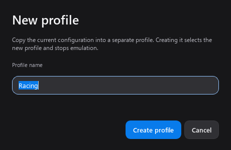

# Desktop workflow

## Find the right workspace

Use the sidebar for **Device lab**, **Guided test**, **Emulation**,
**Saved sessions**, **Game profiles** and **Settings**. Diagnostic tabs stay
together under Device lab. Opening Settings or Game profiles keeps you
inside the main window; changing pages does not stop an active virtual output.

The summary includes an active-profile picker and a **••• Controller options** menu
for profile management, mapping, appearance and device details. A profile change
stops output. **Stop emulation** remains visible beside the page title while output is
active, including when viewing sessions or settings.

Settings has **General**, **Controller** and **Help** categories. Emulation starts
with output selection and optional vibration; expand **Advanced adjustments**
for tuning and remapping, or **Connection help** for driver and double-input tools.
The signal path shows the selected physical input and virtual target; it animates
only while forwarding is active. Settings → General includes **Reduce interface
motion**, which disables transitions and visual smoothing. Save and Discard remain
accessible below the scrolling General settings form.

## Create separate named configurations

Choose **+** beside **Active profile**, or open the dropdown and choose
**New profile…**. Enter a name such as Racing or Swapped buttons and choose
**Create profile**. The current visible mappings, appearance, preview deadzone
and emulation adjustments are copied, including adjustments not yet saved.

Creation selects the new profile and stops any active emulation. It does not
change Default or another preset. Make further changes and choose
**Save adjustments to profile** to save emulation tuning and button remaps.
Switch between named configurations in the same dropdown; selection persists
across restarts. Use **Manage profiles…** to rename or delete a named preset.

Names must be nonempty, unique for that controller and at most 80 characters.
Default remains the built-in preset. Cancel leaves the current configuration
alone, and a failed save does not replace the active profile. If the controller
changes while entering the name, reopen creation for the intended controller.



## First-run assistant

The normal Windows app opens a four-step assistant on first launch:

1. Connect and choose a controller.
2. Review the input mapping. Use **Map inputs** and **Listen** for adapters or
   controllers without a usable automatic mapping.
3. Optionally choose **Check virtual outputs**. The check creates and removes
   neutral Xbox 360 and DualShock 4 targets in a separate process. It does not
   forward controller input or request vibration. A failed check displays the
   actual client error; diagnostics remain available without emulation.
4. Review how to start emulation, configure game profiles and use the stop shortcut.

Choose **Skip for now** to dismiss the first-run assistant. Reopen it with
**Help → Setup assistant** or **Settings → Help**. The assistant links to official driver information
and HidHide documentation, but does not install drivers or change device hiding.

## System tray and stop shortcut

The Windows tray menu provides **Open Controller Lab**, **Stop emulation**,
**Game profiles**, **Desktop settings** and **Quit Controller Lab**.
Click the icon to restore the window. Windows may place it in the hidden-icons area.

Under **Settings → General**, optionally enable minimize-to-tray or
close-to-tray. Both are off initially. Normal close exits; **Quit Controller Lab**
always stops and detaches output, releases the shortcut and exits, even when
close-to-tray is enabled. If the tray is unavailable, closing still exits.

The global stop shortcut defaults to **Ctrl+Alt+F11**. It works while another app
has focus. Change it or disable it in **Settings → General**. Use Ctrl or Alt with a
letter, number or function key; F12 and Windows-key combinations are reserved.
If Windows cannot register a replacement, the dialog displays the error and
keeps the previous shortcut. A second app instance can cause a shortcut conflict.
The shortcut stops emulation; it never starts it. There is no keyboard hook.

## Automatic game profiles

1. Connect a controller and create any desired presets under **Controller options → Manage profiles**.
2. Open **Game profiles** in the sidebar and enable automatic selection.
3. Choose **New game**, give it a name, browse to its actual game `.exe`,
   and select a controller profile. Use **Add game** when adding several rules.
4. Choose **Save**. This also includes the latest edited game. Rules and the enable
   switch are drafts until saved; **Discard changes** restores saved values.
5. Open the game. Controller Lab checks configured executable paths approximately
   every two seconds while it is running, including while minimized to the tray.

Rules match full paths case-insensitively, not just filenames. A launcher and its
game can have different executables; select the one that remains running during
play. Moved or renamed games need an updated rule. Elevated/protected processes
may not expose their full path to an ordinary app.

Rules apply to the selected controller's reported model GUID. The default preset
can be selected too. Identical controllers may share this GUID. A deleted named
preset produces a missing-profile message rather than silently selecting Default.

With multiple matching games open, focus a game to choose its rule. That choice
is retained when alt-tabbing to another app. If several games are open with no
previous or focused match, the app asks you to focus one. When the chosen game
closes, another matching game can take over; when none remain, the saved manual
profile returns. Automatic selections are temporary and never saved as your
manual profile, including across an app restart.

Selecting a profile manually pauses automatic selection until matching games
close, or until **Game profiles → Save** is used again. Editing rules does not
launch games. Background results from old rules or a previous controller are
discarded. Detection pauses while the Game profiles page is open so editing a
rule does not change the current profile. It resumes when you leave that page.

Any profile change stops virtual output and ends an active recording. Press
**Start emulation** yourself after reviewing the loaded configuration. Repeated
checks do not interrupt output when the selected profile stays the same. Pressing
the stop shortcut does not cause automatic output to restart.

## Verification and limits

Demo and offscreen modes do not register a system shortcut, create a tray icon,
scan running games or open the first-run assistant automatically. Dialog preview
captures use explicitly simulated controllers and game rules.

An explicit developer check is available:

```powershell
.\ControllerLab.exe --desktop-check desktop-check.json
```

It reads its own executable path, registers and releases a temporary shortcut,
and sends a message to its own event queue to verify native shortcut routing.
It does not synthesize keyboard presses, create virtual output, forward physical
inputs or request vibration. A successful check does not replace testing the
shortcut while playing, game input, double input, Bluetooth or vibration.

The Windows implementation follows the official
[RegisterHotKey documentation](https://learn.microsoft.com/en-us/windows/win32/api/winuser/nf-winuser-registerhotkey),
[process snapshot example](https://learn.microsoft.com/en-us/windows/win32/toolhelp/taking-a-snapshot-and-viewing-processes),
and Qt's [native event filters](https://doc.qt.io/qtforpython-6/PySide6/QtCore/QAbstractNativeEventFilter.html)
and [system tray API](https://doc.qt.io/qtforpython-6/PySide6/QtWidgets/QSystemTrayIcon.html).
